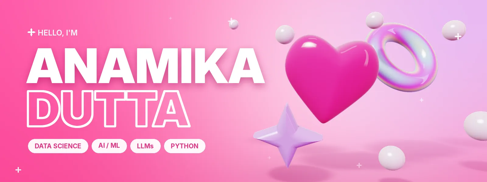

  

  

  
  
  
  

## 🌸 About me

- 🎓 B.Tech CSE (Data Science) at **Amity University, Noida**, class of 2027
- 🤖 I build end-to-end AI systems: agentic AI, LLM apps, computer vision, and ML for healthcare and fintech
- ☁️ **AWS Cloud Practitioner** and **Cisco CCNA** certified
- 🐍 Python is home, with C++ and SQL close behind
- 🥇 Fun fact: two-time gold medallist with my college Kho Kho team

## 💼 Experience

**AI/ML Intern, Ministry of Electronics & IT (MeitY), INDIAai** · May 2026 – Jul 2026
 Knowledge-Driven Analytics for Multi-Sector Decision Making

- 🗂️ Built a 4-module pipeline that organised **10,449 government datasets** on India's AIKosh platform, with 80.7% automated acquisition and **92.5% primary-key detection accuracy**
- 🧩 Used similarity fusion and hierarchical clustering to lift domain purity from **78.4% to 96.1%**
- 🦙 Used Llama 3.2 to suggest cross-sector use cases (like pairing agriculture and weather data for crop-yield forecasting)

## 🎀 Tech stack

  

## 💗 Featured projects

| Project | What it does | Built with |
|---|---|---|
| 💸 [**LyRA**](https://github.com/anamaniac16/LyRa-your-financial-assistant) | Agentic AI financial assistant that turns plain-English commands into bill payments, subscription management and purchases through Playwright browser automation | `Python` `PyTorch` `Playwright` |
| 🦷 [**Dental AI**](https://github.com/anamaniac16/Dental-AI-Project-Hack4-HealthIIITD) | Full-stack dental diagnosis platform: a CNN ensemble gives a health score, urgency triage and per-condition probabilities in under 0.2 s, with patient and dentist dashboards | `Django REST` `CNN` `Docker` |
| 🩺 [**Health Guard AI**](https://github.com/anamaniac16/AI-health-score-checker-and-diabetes-detector) | Preventive-health and diabetes risk system: XGBoost plus a rule engine gives a 0–100 risk score, SHAP explanations and personalised diet and workout plans | `XGBoost` `SHAP` `Streamlit` |
| 🎗️ [**Breast Cancer Detector**](https://github.com/anamaniac16/Breast-Cancer-Detector-tab) | Breast cancer detection with ML and deep learning on clinical (tabular) and medical-image data, evaluated with ROC-AUC | `Python` `scikit-learn` `Deep Learning` |

## 🏆 Achievements

- 🏅 Certificate of Excellence, **Techfest 2026 FinAgent Hackathon** (IIT Bombay) for an AI-driven fintech project
- 🌍 Represented Jordan on the UNHCR committee at **AMIMUN**
- 🥇 Gold medal twice in inter-college **Kho Kho** tournaments

## ✨ GitHub stats

  

  
  

  

